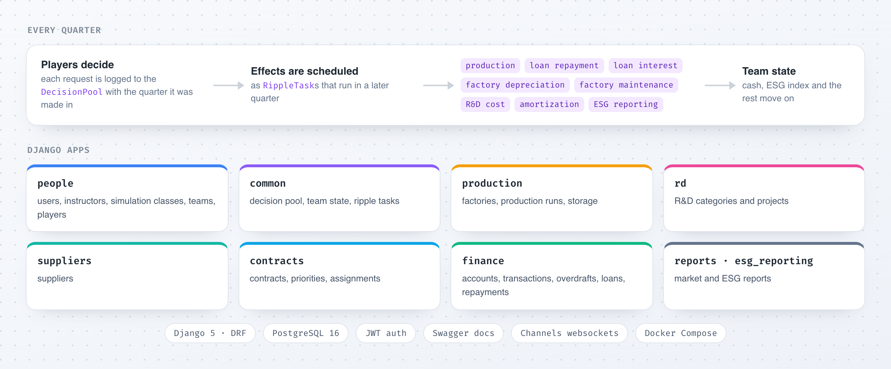

<div align="center">

# Hubro · Backend

**The server behind a classroom business simulation, where student teams run a company quarter by quarter.**<br>
Django 5 &nbsp;·&nbsp; Django REST Framework &nbsp;·&nbsp; PostgreSQL 16 &nbsp;·&nbsp; Channels

<br>



</div>

<br>

An instructor opens a simulation class and the students split into teams. Each team runs a company: it builds factories and plans production, funds R&D projects, buys from suppliers, wins contracts, borrows and repays, and reports on ESG. Decisions take effect over time. A loan's interest, a factory's depreciation or a finished production run lands in a later quarter, as a *ripple task*, and the team's state moves on.

## Running it

You'll need [uv](https://docs.astral.sh/uv/) and Docker.

```bash
uv sync
cp .env_sample .env          # then fill it in (see below)
docker compose up -d         # PostgreSQL, plus pgAdmin on localhost:5050
./reset_db.sh                # migrate, then load suppliers, financial accounts and dev superusers
uv run python manage.py seed # optional: sample classes, teams and players
uv run python manage.py runserver
```

For the local database, the `.env` values are `PGHOST=localhost`, `PGNAME=hubro_db`, `PGUSER=hubro_user`, `PGPASSWORD=hubro_password` and `PGPORT=5432`, plus any `DJANGO_SECRET`. These are local development defaults only. To serve the API from another domain, add it to `ALLOWED_HOSTS` and `CORS_ALLOWED_ORIGINS` in `config/settings.py`.

## Exploring the API

Swagger lives at **`localhost:8000/swagger/`**. Get a token by posting one of the development accounts from `common/management/seed_data.py` to `/api/v1/auth/token/`, click **Authorize**, and paste the `access_token`. Access tokens last a week; post the `refresh_token` to `/api/v1/auth/token/refresh/` for a new one.

`./reset_db.sh -r` rebuilds the database and its migrations from scratch. It deletes every migration file first, so use it with care.

## Team

- Davoud Nosrati Amirabadi &nbsp;[@ausdavoud](https://github.com/ausdavoud)
- Dvin Avanesian &nbsp;[@DvinAvanesian](https://github.com/DvinAvanesian)
- Ahmad
